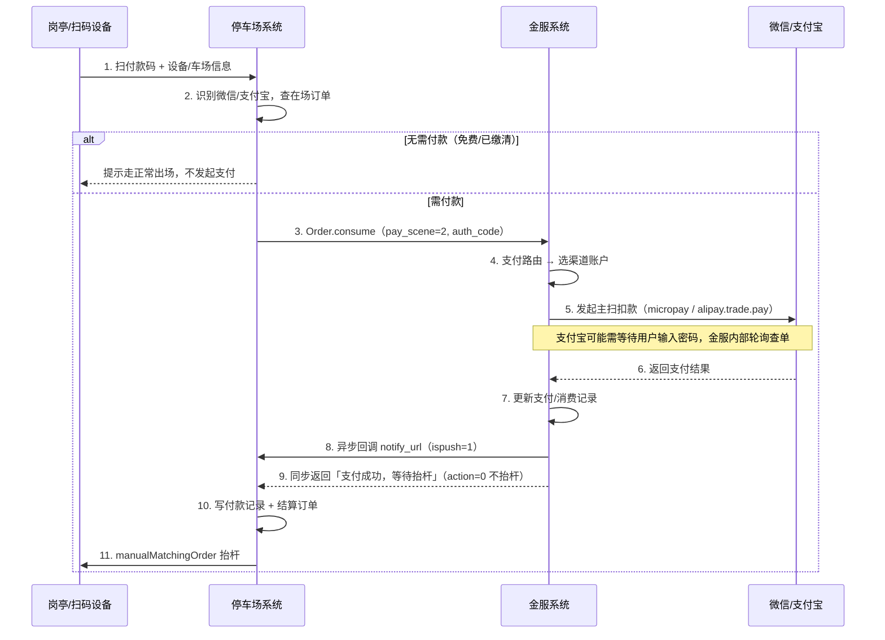

# 微信 / 支付宝主扫出场支付流程说明

> **文档版本**：2026-07  
> **适用场景**：停车场岗亭扫码枪扫用户付款码（主扫）出场缴费  
> **涉及系统**：停车场系统（iparkcloud_jdz） + 金服支付系统（ifinancial4_jdz）  
> **阅读对象**：业务负责人、项目经理、运维及技术对接人员  

---

## 一、什么是「主扫」

| 术语 | 含义 | 典型场景 |
|------|------|----------|
| **主扫** | 商户用扫码设备扫**用户手机上的付款码** | 岗亭扫码枪扫微信/支付宝付款码出场 |
| **被扫** | 用户扫**商户展示的收款码** | 自助缴费机、静态二维码 |
| **公众号/H5** | 用户在手机端打开支付页面完成付款 | 微信公众号缴费、小程序缴费 |

**主扫出场**的业务目标：车辆到达出口、系统判定需缴费后，收费员或设备扫描用户付款码，完成在线支付，支付成功后自动抬杆放行。

---

## 二、整体架构（两个系统如何配合）

```
┌─────────────────────┐         ┌─────────────────────┐         ┌──────────────────┐
│   停车场系统         │  HTTP   │   金服支付系统       │  HTTPS  │  微信 / 支付宝    │
│  (iparkcloud_jdz)   │ ──────► │ (ifinancial4_jdz)   │ ──────► │  官方支付接口      │
│                     │         │                     │         │                  │
│  查单、组装参数      │ ◄────── │  路由、扣款、记账    │ ◄────── │  同步返回支付结果  │
│  写付款记录、抬杆    │  回调   │  异步通知业务系统    │         │                  │
└─────────────────────┘         └─────────────────────┘         └──────────────────┘
```

| 系统 | 职责 |
|------|------|
| **停车场系统** | 判断是否需要付款、查询在场订单、识别付款码类型、调用金服消费接口、接收支付成功回调后写付款记录并抬杆 |
| **金服系统** | 根据商户路由选择支付渠道、调用微信/支付宝官方接口完成扣款、更新消费/支付记录、回调停车场 `notify_url` |
| **微信/支付宝** | 实际扣款、返回支付结果（成功 / 需用户输入密码 / 失败） |

---

## 三、完整业务流程（领导视角）

### 3.1 出场主扫时序图



### 3.2 关键设计说明（为何同步不抬杆）

主扫出场采用 **「同步确认支付 + 异步完成出场」** 两段式处理：

| 阶段 | 做什么 | 为什么不直接在同步阶段抬杆 |
|------|--------|---------------------------|
| **同步返回** | 金服确认渠道扣款成功，停车场返回 `action=0`（不开闸） | 出场收尾（写付款记录、订单结算、抬杆）统一走回调，避免同步与回调重复执行 |
| **异步回调** | 金服通知停车场 `scanPayNotifyListener`，写付款记录后调用 `manualMatchingOrder` 抬杆 | 与现有无人值守/扫码缴费回调机制一致，保证账务与出场状态一致 |

**对岗亭人员的体验**：扫码后界面提示「支付成功，等待抬杆」；支付回调到达后道闸自动抬起。

---

## 四、停车场侧流程（iparkcloud_jdz）

**入口接口**：`HemaFinishRecordService.scanCodeOutPlateNumber`  
（同类逻辑亦存在于 `ExternallyService.scanCodeOutPlateNumber`）

### 4.1 步骤说明

| 步骤 | 动作 | 失败时表现 |
|------|------|------------|
| 1 | 校验付款码格式，识别微信或支付宝 | 返回「付款码格式错误」 |
| 2 | 根据设备/车场查在场订单，确认应付金额 > 0 | 无订单、多笔订单、免费时段等返回对应提示 |
| 3 | 组装参数，调用金服 `Order.consume` | 返回金服错误信息（如路由未配置、渠道停用） |
| 4 | 同步返回成功，`action=0`，等待回调抬杆 | 岗亭不立即开闸 |
| 5 | 金服回调 `NotifyService.scanPayNotifyListener` | 写付款记录 → 结算 → `manualMatchingOrder` 抬杆 |

### 4.2 调用金服时的核心参数

| 参数 | 含义 | 示例/说明 |
|------|------|-----------|
| `percode` | 业主（停车场管理公司）编号 | 如景德镇测试对应业主编号 |
| `no` | 停车订单号 | 在场订单 orderid |
| `online_fee` | 在线支付金额 | 应付停车费 |
| `auth_code` | 用户付款码 | 扫码枪读取的条码 |
| `pay_scene` | **固定为 2** | 标识「商户扫用户付款码」 |
| `channel` | 支付渠道 | 1=支付宝，3=微信 |
| `channel_auto` | 渠道自动选择 | 2=优先服务商子商户渠道 |
| `notify_url` | 支付成功回调地址 | 携带 `ispush=1` 及出场参数 |

### 4.3 付款码识别规则

| 渠道 | 付款码特征 |
|------|------------|
| **支付宝** | 25~28 开头，总长 16~24 位数字 |
| **微信** | 10~15 开头，总长 18 位数字 |

### 4.4 回调地址携带的出场信息

回调 URL 中通过 `ispush=1` 和 `data` 参数传递出场所需信息，供 `manualMatchingOrder` 使用：

- `orderid`：订单号  
- `platenumber`：车牌号  
- `parkinglotid`：停车场 ID  
- `comid`：业主 ID  
- `entryid`：岗亭 ID  
- `equipmentid`：扫码设备 ID  
- `userid`：操作人（可选）  

---

## 五、金服侧流程（ifinancial4_jdz）

**入口接口**：`OrderService.consume` → `ConsumeService.consume`

### 5.1 主扫专用路由（与原有支付隔离）

当请求携带 `pay_scene=2` 时，金服**不走**原有 `AliPayTrade` / `WeiXinTrade` 的公众号、被扫等逻辑，而是进入独立主扫模块：

```
Order.consume (pay_scene=2)
    → ConsumeService（创建消费单、支付路由）
    → ChannelRoute.getPayAccount（按商户路由选渠道）
    → ChannelTradeService.getOrderInfo
    → MerchantScanTrade（主扫统一入口）
        ├─ channel=支付宝 → MerchantScanAliPayTrade
        └─ channel=微信   → MerchantScanWeiXinTrade
    → MerchantBarcodePayHelper.completeMerchantBarcodePay
    → ChannelNotify.payNotify（更新记录 + 回调 notify_url）
```

**设计目的**：主扫为新增能力，与存量支付宝/微信支付逻辑隔离，降低对现有缴费方式的影响。

### 5.2 支付路由（交易能否成功的关键配置）

交易前，金服根据 **业主（partner）+ 支付类型 way** 查询商户路由表 `fa_biz_channel_route`：

| 支付类型 | way 编码 | 名称 |
|----------|----------|------|
| 微信主扫 | `003000005` | 微信刷卡支付 |
| 支付宝主扫 | `001000005` | 支付宝刷卡支付 |

若未配置对应路由，返回错误 **`route_empty`（无符合条件的支付路由配置数据）**。

### 5.3 支付路由配置三层结构（上线前必配）

```
① 支付渠道账户（fa_biz_pay_account）
        ↓ 绑定支付类型
② 渠道支付类型（fa_biz_channel_way）  ← 必须包含 003000005 / 001000005
        ↓ 服务商级配置
③ 服务商路由（owner_type=1）
        ↓ 业主级配置
④ 商户路由（owner_type=2）            ← 交易实际使用的路由
```

> **注意**：仅新建「支付渠道账户」不够；须完成渠道支付类型 + 服务商路由 + 商户路由，主扫交易才能路由到正确账户。

---

## 六、微信支付主扫（技术细节）

### 6.1 调用方式

| 项目 | 说明 |
|------|------|
| 实现类 | `MerchantScanWeiXinTrade` |
| 官方接口 | 微信付款码支付 **/pay/micropay** |
| 复用逻辑 | 内部调用 `WeiXinTrade.doAuthCodePay`，复用查单、撤单等成熟逻辑 |
| 支付类型 | `way = 003000005`（微信刷卡支付） |

### 6.2 处理流程

1. 校验 `auth_code` 非空  
2. 根据路由获取微信支付账户（含服务商子商户信息）  
3. 调用微信 micropay 接口发起扣款  
4. 若返回「用户支付中」，内部轮询查单直至成功或超时  
5. 支付完成后调用 `ChannelNotify.payNotify`  
6. 若请求中带有 `notify_url`，异步 HTTP 通知停车场  

### 6.3 微信主扫特点

- **同步性较强**：多数情况下 micropay 可直接返回最终结果  
- **需配置微信商户号/子商户号**：服务商模式下须配置业主子商户映射（`partnerChannelMap`）  
- **付款码有效期短**：用户付款码约 1 分钟有效，扫码后应尽快发起交易  

---

## 七、支付宝支付主扫（技术细节）

### 7.1 调用方式

| 项目 | 说明 |
|------|------|
| 实现类 | `MerchantScanAliPayTrade` |
| 官方接口 | **alipay.trade.pay**（当面付条码） |
| 场景参数 | `scene=bar_code`，`product_code=FACE_TO_FACE_PAYMENT` |
| 支付类型 | `way = 001000005`（支付宝刷卡支付） |

### 7.2 处理流程

1. 校验 `auth_code`，读取支付渠道配置（appId、RSA 私钥等）  
2. **服务商模式**（`is_agent=2`）：须传入子商户授权令牌 `app_auth_token`（来自 `partnerChannelMap.pay_token`）  
3. 调用 `alipay.trade.pay` 发起扣款  
4. 根据返回码处理：  

| 返回 code | 含义 | 金服处理 |
|-----------|------|----------|
| `10000` | 支付成功 | 直接记成功 |
| `10003` | 等待用户输入密码 | 等待 3 秒后轮询查单（默认最多 5 次，间隔 5 秒） |
| `20000` | 系统繁忙 | 同上，轮询查单 |
| 其他 | 支付失败 | 返回失败；必要时尝试撤单 |

5. 支付完成后同样走 `ChannelNotify.payNotify` → 回调停车场  

### 7.3 支付宝主扫特点

- **可能需要用户输入密码**：同步请求会阻塞数秒至数十秒（轮询查单），属正常现象  
- **服务商授权令牌敏感**：`pay_token` 过期会导致 `aop.invalid-app-auth-token` 错误，需重新授权  
- **停车场景扩展参数**：支持向支付宝传递车牌、停车场等行业回流信息（`industry_reflux_info`）  

---

## 八、微信 vs 支付宝主扫对比

| 对比项 | 微信主扫 | 支付宝主扫 |
|--------|----------|------------|
| 付款码规则 | 10~15 开头，18 位 | 25~28 开头，16~24 位 |
| 金服 channel | 3（微信） | 1（支付宝） |
| 路由 way | `003000005` | `001000005` |
| 官方接口 | `/pay/micropay` | `alipay.trade.pay` |
| 用户输密码 | 较少，偶发需查单 | 较常见，返回 10003 后查单 |
| 服务商模式 | 子商户号 `sub_mch_id` | 子商户授权 `app_auth_token` |
| 实现类 | `MerchantScanWeiXinTrade` | `MerchantScanAliPayTrade` |

---

## 九、与「被扫 / 公众号支付」的区别

| 维度 | 主扫出场（本方案） | 公众号/被扫等传统方式 |
|------|-------------------|----------------------|
| 触发方式 | 岗亭扫用户付款码 | 用户扫码或打开支付页 |
| 标识参数 | `pay_scene=2` + `auth_code` | 无 pay_scene 或 JSAPI/Native 等 way |
| 代码路径 | `MerchantScanTrade` 独立模块 | `AliPayTrade` / `WeiXinTrade` |
| 同步结果 | 通常直接得到支付成败 | 多数需用户确认后异步通知 |
| 出场抬杆 | 同步 action=0，回调抬杆 | 依赖各自回调机制 |
| 路由 way | `003000005` / `001000005` | `003000001` 公众号等其它 way |

---

## 十、关键接口与代码位置

### 10.1 停车场系统（iparkcloud_jdz）

| 模块 | 路径 | 说明 |
|------|------|------|
| 主扫出场入口 | `std/app/.../HemaFinishRecordService.java` | `scanCodeOutPlateNumber` |
| 支付回调 | `lots/fa/.../NotifyService.java` | `scanPayNotifyListener` |
| 付款码识别 | `HemaFinishRecordService.getPayTypeByAuthCode` | 区分微信/支付宝 |

### 10.2 金服系统（ifinancial4_jdz）

| 模块 | 路径 | 说明 |
|------|------|------|
| 消费入口 | `com/pay/service/OrderService.java` | `consume`，文档注明 pay_scene=2 |
| 消费逻辑 | `com/tra/service/ConsumeService.java` | 路由、调渠道 |
| 支付路由 | `com/cha/ChannelRoute.java` | `getRoutePayAccount` |
| 主扫入口 | `com/cha/trade/MerchantScanTrade.java` | 按渠道分发 |
| 微信主扫 | `com/cha/trade/MerchantScanWeiXinTrade.java` | micropay |
| 支付宝主扫 | `com/cha/trade/MerchantScanAliPayTrade.java` | alipay.trade.pay |
| 公共收尾 | `com/cha/trade/MerchantBarcodePayHelper.java` | 完成支付并回调 |
| 通知处理 | `com/cha/ChannelNotify.java` | `payNotify` |

---

## 十一、常见问题与排查

| 现象 | 可能原因 | 处理建议 |
|------|----------|----------|
| `route_empty` | 商户路由未配置主扫 way | 按「三层路由」补全 `003000005` / `001000005` |
| `pay_account_disabled` | 支付账户或商户子渠道停用 | 检查账户 status、子商户 status=启用 |
| `付款码格式错误` | 条码不是微信/支付宝付款码 | 确认用户展示的是付款码而非收款码 |
| `当前订单无需支付` | 免费时段或金额为 0 | 走正常免费出场，不应调用主扫 |
| 支付宝 `invalid-app-auth-token` | 子商户授权 token 失效 | 重新做支付宝服务商授权，更新 pay_token |
| 同步成功但不抬杆 | 回调失败或未到达 | 查金服 notify 日志、停车场 `scanPayNotifyListener` 日志 |
| `state=3` 且 Logging 报错 | 运行时 jar 版本不一致 | 检查 `base.jar` 是否与代码匹配，或关闭 MQ 通知 |

### 11.1 路由配置自查 SQL（运维参考）

```sql
-- 1. 渠道账户是否启用
SELECT id, name, channel, status, is_agent, merchant_id
FROM fa_biz_pay_account WHERE name LIKE '%目标渠道%';

-- 2. 是否配置主扫支付类型
SELECT w.id, w.way, w.status, a.name
FROM fa_biz_channel_way w
JOIN fa_biz_pay_account a ON a.id = w.pay_account_id
WHERE w.way IN ('003000005', '001000005');

-- 3. 商户路由是否指向该渠道（owner_type=2 为业主路由）
SELECT p.name partner_name, w.way, a.name pay_account, r.status
FROM fa_biz_channel_route r
JOIN fa_biz_partner p ON r.owner_id = p.id
JOIN fa_biz_channel_way w ON w.id = r.way_id
JOIN fa_biz_pay_account a ON a.id = w.pay_account_id
WHERE r.owner_type = 2 AND p.no = '业主编号';
```

---

## 十二、上线检查清单

### 业务侧

- [ ] 确认目标停车场业主已在金服开户  
- [ ] 确认出场流程「需付款」时才调用主扫，免费出场不走支付  
- [ ] 岗亭扫码设备可正常读取付款码  

### 金服配置侧

- [ ] 支付渠道账户已创建并启用  
- [ ] 渠道支付类型已添加：`003000005`（微信）、`001000005`（支付宝）  
- [ ] 服务商路由（owner_type=1）已配置  
- [ ] 商户路由（owner_type=2）已配置到目标业主  
- [ ] 服务商模式下子商户授权/token 有效  

### 联调验证侧

- [ ] 微信付款码：同步返回成功 + 回调抬杆  
- [ ] 支付宝付款码：含需输密码场景（10003）  
- [ ] 回调 `ispush=1` 路径：`addOrderPrePayRecord` → `manualMatchingOrder` 正常  
- [ ] 支付金额与订单应付一致，付款记录写入正确  

---

## 十三、总结（给领导的一段话）

主扫出场是：**岗亭扫用户微信/支付宝付款码 → 停车场向金服发起消费 → 金服按预先配置的路由调用官方接口扣款 → 扣款成功后回调停车场完成记账并抬杆**。

与公众号缴费不同，主扫由**商户主动扫用户**，同步即可知道扣款是否成功，但**抬杆统一放在支付回调**，保证账务与放行一致。

微信、支付宝在技术实现上走独立主扫模块（`pay_scene=2`），通过不同的官方接口和路由编码（`003000005` / `001000005`）完成扣款；**上线前必须完成支付路由三层配置**，否则会出现「选不到渠道」或 `route_empty` 导致无法支付。

---

*文档依据当前代码库整理，如有配置变更以实际环境为准。*
